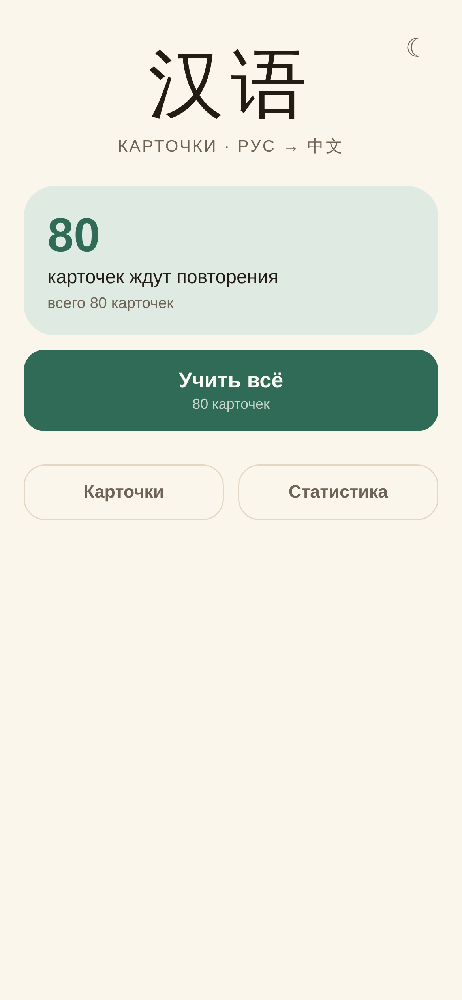
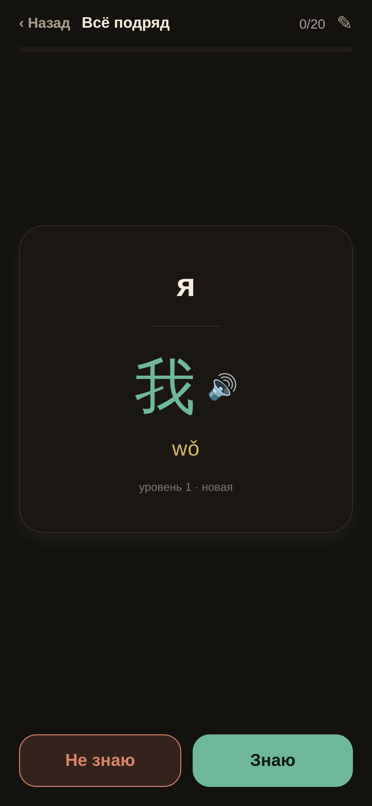

# chinese-cards

A small, offline-first flashcard system for learning Chinese from Russian:
an Android app built with Expo, a Go sync server, and plain-text deck files.

<p>
  
  
</p>

The app has one job: show a Russian word, let you recall the Chinese one, and
schedule it with a fixed ladder — **0, 1, 3, 7, 16, 40, 90, 200, 400 days**.
There are only two answers: *know* and *don't know*. No ease factors, no daily
limits, no settings screen.

## What is here

| Path | What it is |
|---|---|
| `mobile/` | Expo / React Native app: study screen, cards, statistics, local SQLite mirror |
| `server/` | Go HTTP API and SQLite store; imports `.deck` files and serves the APK index |
| `decks/` | Source decks in the human-readable `.deck` format |
| `bin/` | `run`, `check`, `apk`, `push`, `db` |
| `docs/` | Product notes and decisions (mostly Russian) |

## Features

- **Study flow** — tap or swipe a card; swipe past 30% of the width to answer.
  A wrong answer comes back a few cards later, then again in ten minutes.
- **Offline first** — cards, statistics and the study queue are read from the
  phone's SQLite mirror. A sync pulls changes and pushes edits and tombstones.
- **Pinyin, notes, speech** — each card may carry pinyin and a note; the Chinese
  side can be spoken with the system TTS.
- **Editing and deleting** — cards can be edited or deleted on the phone. A
  tombstone prevents a deleted card from coming back on the next sync.
- **Light and dark themes** — the choice survives restarts.
- **One server per build** — the app has no server address field. The URL is
  compiled in from `EXPO_PUBLIC_API_URL`; the token from
  `EXPO_PUBLIC_API_TOKEN`. The checked-in fallback points at the author's
  instance; set your own URL and token for a self-hosted deployment.
- **Plain-text source** — decks are diffable files, not a binary Anki database.

## Deck format

A deck is one file, one card per line:

```
!deck chinese/01-pronouns
!title Местоимения
!src ru>zh

# comments start with #

я = 我 [wǒ]
ты = 你 [nǐ]
она = 她 [tā]
оно = 它 [tā] // for inanimate objects
они (только женщины) = 她们 [tāmen]
```

The left side is Russian, the right side is Chinese, `[...]` is pinyin, and
`// ...` is an optional note. The server imports the whole `decks/` directory on
startup and on `POST /api/sync`.

## Run the server

```sh
cd server
DECK_DIR=../decks DB=../data/cards.db ADDR=:8787 go run ./cmd/server
```

Or from the repository root:

```sh
bin/run
```

Environment:

| Variable | Default | Meaning |
|---|---|---|
| `ADDR` | `:8787` | listen address |
| `DB` | `./data/cards.db` | SQLite file |
| `DECK_DIR` | `./decks` | directory scanned for `.deck` files |
| `APK_DIR` | `./dist/apk` | directory served at `/apk/` |
| `CARDS_TOKEN` | empty | if set, API requests need `Authorization: Bearer <token>` |
| `AGENT_WEBHOOK` | empty | optional webhook called after changes |

Without `CARDS_TOKEN` all API endpoints are open. Set it before exposing the
server outside your machine.

## Build the app

```sh
cd mobile
npm ci
cp .env.example .env          # set the API URL and token for your server
npm start                     # Expo dev server
```

For an installable Android APK the project uses EAS Build:

```sh
npx eas-cli build --platform android --profile preview
```

`bin/build-expo` wraps the same command, `bin/apk` waits for the build and
downloads the artifact, and `bin/push` publishes a JS update to the `preview`
channel. These scripts expect an Expo account and `EXPO_TOKEN` (or a token in
`~/.config/expo-token`).

The web target is not the primary product, but the same screens run in a
browser:

```sh
npx expo export --platform web
```

`expo-sqlite` needs `Cross-Origin-Opener-Policy: same-origin` and
`Cross-Origin-Embedder-Policy: require-corp` when served; a plain static server
is not enough for the database worker.

## API

| Method | Path | Purpose |
|---|---|---|
| `GET` | `/api/health` | liveness |
| `GET` | `/api/decks` | decks and due counts |
| `GET` | `/api/study?deck=` | next cards for a session |
| `POST` | `/api/review` | record an answer with an idempotent `event_id` |
| `GET` | `/api/stats` | server-side statistics |
| `GET` | `/api/changes?since=` | cards and tombstones changed since a timestamp |
| `PATCH` | `/api/cards/{id}` | edit a card |
| `DELETE` | `/api/cards/{id}` | delete a card (tombstone) |
| `POST` | `/api/import` | import a deck body |
| `POST` | `/api/sync` | re-scan `DECK_DIR` |
| `GET` | `/api/digest` | Markdown summary for an agent |
| `GET` | `/apk/` | APK index |

## Checks

```sh
bin/check              # server vet/tests + app typecheck/unit tests
CHECK_FULL=1 bin/check # also export the Android bundle
```

## Limits

- One user, one account, no sign-up.
- The `.deck` file is the source of truth; an edit on the phone loses to a
  later file import when the same card changes in both places.
- Creating cards in the app is not supported; edit the deck files.
- Only Android is built; iOS is not tested.
- No Anki import or export.

## License

MIT. See [LICENSE](LICENSE).
