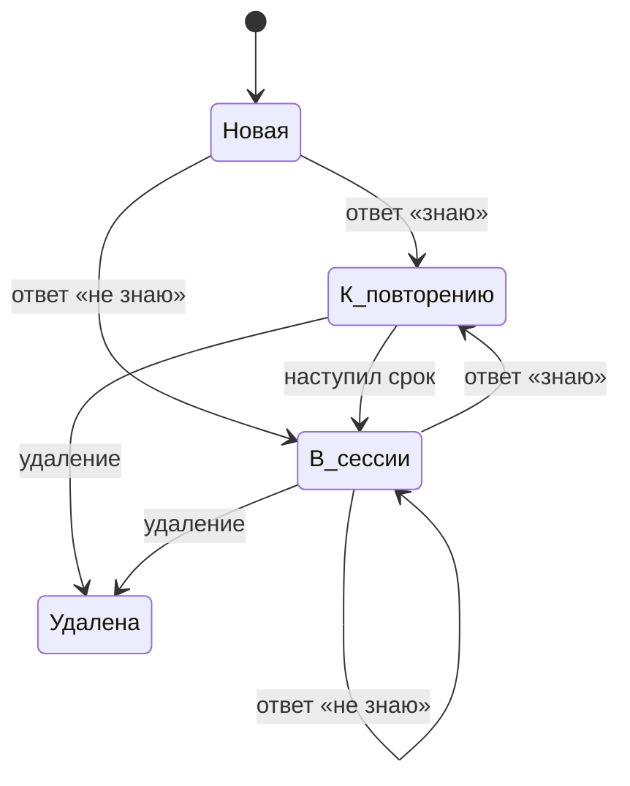

# Карточка

## Что это
Пара «русский → китайский» с пиньинем и необязательной заметкой.

## Состояния

## Действия
Пользователь отвечает «знаю» или «не знаю», свайпает карточку влево или вправо, слушает произношение, правит текст карточки, удаляет её.

## Критерии приёмки
- Дано новая карточка, когда ответ «знаю», тогда карточка поднимается на ступень и уходит из сессии.
  Проверка: `go test ./internal/scheduler`.
- Дано ответ «не знаю», когда сессия продолжается, тогда карточка возвращается через три карточки и снова через десять минут в расписании.
  Проверка: `go test ./internal/scheduler` и `src/lib/queue.ts`.
- Дано карточка в сессии, когда пользователь её правит, тогда новый текст виден локально сразу.
  Проверка: ручной сценарий.
- Дано открытый ответ, когда свайп прошёл порог, тогда ответ засчитывается: вправо — «знаю», влево — «не знаю».
  Проверка: ручной сценарий.
- Дано открытый ответ, когда свайп не дошёл до порога, тогда карточка пружиной возвращается в центр и ответ не засчитывается.
  Проверка: ручной сценарий.
- Дано открытый ответ, когда нажата кнопка звука, тогда китайская сторона произносится вслух.
  Проверка: ручной сценарий.

## Границы
- Обратного направления «китайский → русский» нет.
- Создания карточек в приложении нет: источник — файлы `.deck`.

## Вопросы
—

## Предложения машины (не канон)
—
