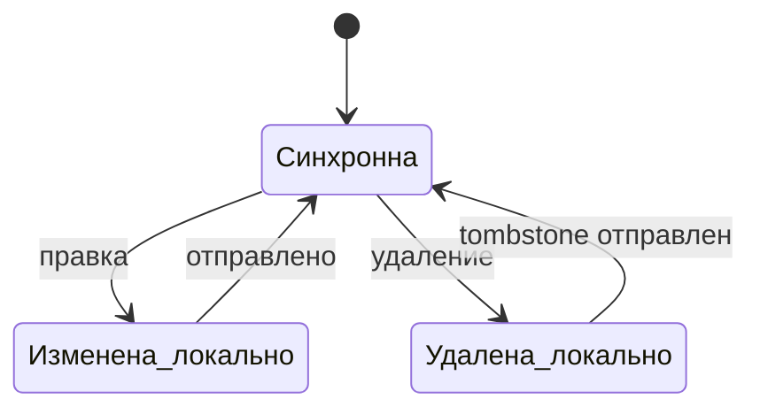

# Локальная база

## Что это
Копия карточек на телефоне, которая живёт без сети и догоняет сервер.

## Состояния

## Действия
Приложение подтягивает изменения с сервера при открытии, отправляет локальные правки и удаления. Статистику, список карточек и очередь сессии считает из локальной базы, а не с сервера.

## Критерии приёмки
- Дано правка без сети, когда сеть появилась, тогда правка уходит на сервер и не возвращается обратно.
  Проверка: `bin/check` (серверные тесты `PATCH /api/cards`), ручной сценарий.
- Дано удаление карточки, тогда она исчезает локально сразу и на сервере после синхронизации.
  Проверка: `bin/check` (`DELETE /api/cards`, tombstones в `/api/changes`) + ручной сценарий.
- Дано карточка удалена на сервере, когда пришла синхронизация, тогда она исчезает на телефоне.
  Проверка: ручной сценарий (два устройства или удаление через API).
- Дано карточка вернулась в файл `.deck`, когда прошёл импорт, тогда её tombstone снимается.
  Проверка: `go test ./internal/store`.
- Дано открытая статистика, когда сети нет, тогда цифры считаются из локальной базы.
  Проверка: ручной сценарий (авиарежим).
- Дано экран карточек, когда он открыт, тогда список показывается из кеша, потом догружается с сервера.
  Проверка: ручной сценарий.
- Дано «Учить всё», когда сети нет, тогда очередь берётся из локальной базы.
  Проверка: ручной сценарий (авиарежим).

## Границы
- Разрешения конфликтов «кто прав» нет: файл `.deck` на сервере главнее правки с телефона.
- Создания карточек в приложении нет.

## Вопросы
—

## Предложения машины (не канон)
—
