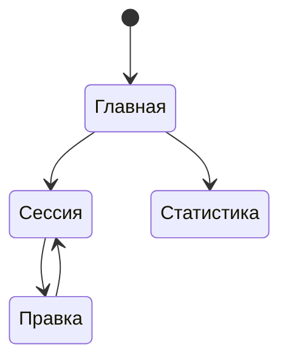

# Приложение

## Что это
Телефонный клиент карточек: учит, правит, удаляет; тема на выбор; адрес сервера не настраивается.

## Состояния

## Действия
Пользователь переключает светлую и тёмную тему, учит карточки, правит и удаляет их.

## Критерии приёмки
- Дано главный экран, когда нажата кнопка темы, тогда тема меняется и выбор сохраняется после перезапуска.
  Проверка: ручной сценарий.
- Дано главный экран, когда он открыт, тогда на нём сводка и кнопка «Учить всё», без списка колод и категорий.
  Проверка: ручной сценарий.
- Дано приложение, когда открыт любой экран, тогда в нём нет поля адреса сервера и слова «Hermes».
  Проверка: `grep -ri hermes mobile/src` пустой.
- Дано агент, когда он обращается к API, тогда он получает колоды, карточки, дельту изменений и сводку.
  Проверка: `bin/check` (`/api/decks`, `/api/changes`, `/api/digest`).

## Границы
- Настроек сервера нет: адрес зашит при сборке.
- Установки и обновления из самого приложения нет.

## Вопросы
—

## Предложения машины (не канон)
—
